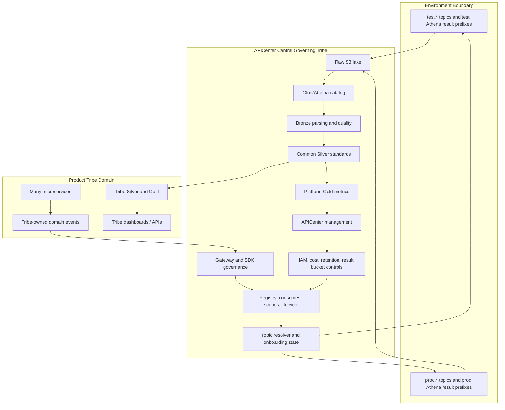

# APICenter Total Data Pipeline Architecture

Date: 2026-05-20

Status: test pipeline is validated end to end for the pilot tribe topic. Production follows the same model but remains gated by production topic approval, production reader approval, and production validation evidence.

## Short Answer: Which Diagram Matches Us?

APICenter is not exactly either reference diagram.

It is closest to the AWS serverless data lake diagram today:

```text
Confluent Kafka topic -> Confluent S3 Sink -> S3 Raw JSON -> Glue/Athena Catalog -> Athena queries -> management/BI
```

But our target operating model borrows from the larger lakehouse diagram:

```text
Source events -> Raw/Bronze -> Common Silver -> Tribe Silver -> Gold -> dashboards/alerts/decisions -> governance feedback
```

The important difference is that APICenter is not a single product database pipeline like the ServEase diagram. APICenter is the central control plane and event governance layer for many tribes. Our primary source is governed event streams, not direct ETL from each tribe's operational database.

So the APICenter-specific answer is:

```text
Tribe services, shared services, and APICenter control-plane events
  -> SDK / APICenter gateway governance
  -> environment-prefixed Kafka topics
  -> Confluent S3 Sink
  -> Raw S3 topic folders
  -> Glue/Athena catalog
  -> Bronze parsed event views
  -> Common Silver standard event envelope
  -> Tribe Silver and platform Silver views
  -> Gold metrics and pipeline health
  -> APICenter management, BI, tribe dashboards, alerts, and governance decisions
```

## North Star

For APICenter, the north-star question is:

```text
From tribe request to gateway decision to event export to visualization,
can we trace who called what, whether it was allowed, what happened,
how much it cost, and where the data landed?
```

That means the data pipeline is not only for dashboards. It is also part of the governance system. It proves:

- which tribe owns the event
- which service produced it
- which environment it belongs to
- whether APICenter accepted or rejected it
- whether it reached Kafka
- whether the S3 Sink flushed it
- whether Athena/Glue can read it
- whether Bronze/Silver/Gold quality checks passed
- whether management or BI is reading from governed result locations
- whether test and prod stayed separated

## Core Design Decisions

### 1. Tribe-Owned Topics, Not Per-Microservice Topics

Visibility is per tribe. Microservices still matter, but they are metadata inside the event.

Default topic model:

```text
logical topic:  tribe.<tribe_id>.events
test topic:     test.tribe.<tribe_id>.events
prod topic:     prod.tribe.<tribe_id>.events
```

Microservice attribution is carried in:

```text
sourceServiceId
```

Example:

```json
{
  "topic": "test.tribe.logistics.events",
  "sourceServiceId": "logistics-orders",
  "eventType": "order.created",
  "payload": {
    "orderId": "ord_123",
    "occurredAt": "2026-05-20T09:41:45.721Z"
  },
  "metadata": {
    "schemaVersion": "1"
  }
}
```

This gives us both:

| Need                      | How we handle it                                    |
| ------------------------- | --------------------------------------------------- |
| Tribe visibility          | Topic is owned by the tribe.                        |
| Microservice traceability | `sourceServiceId` identifies the producing service. |
| Lower Kafka topic sprawl  | One main event lane per tribe per environment.      |
| Later service analytics   | Silver/Gold can group by `source_service_id`.       |

### 2. APICenter Is The Central Governing Tribe

APICenter acts as the central governing tribe or platform tribe.

APICenter owns:

- topic naming rules
- environment prefix rules
- event publish governance
- source service attribution requirements
- event envelope contract
- S3 raw lake layout
- Glue/Athena catalog infrastructure
- Bronze parsing and quality standards
- Common Silver standards
- pipeline health and onboarding state
- access controls for raw, curated, and Athena result data
- cost controls and scan guardrails
- shared-service telemetry
- APICenter control-plane telemetry

Individual product tribes own:

- their domain event meaning
- their domain schemas
- their data steward/owner decisions
- tribe-specific Silver transformations
- tribe-specific Gold metrics
- dashboards or APIs built on their approved curated data

### 3. Test And Prod Are First-Class Separate Environments

Test is not a fake version of prod. It is a separate lane with its own physical topics and result prefixes.

| Layer                      | Test                                                      | Prod                                                      |
| -------------------------- | --------------------------------------------------------- | --------------------------------------------------------- |
| Tribe event topic          | `test.tribe.<tribe_id>.events`                            | `prod.tribe.<tribe_id>.events`                            |
| Shared-service event topic | `test.api-center.shared.<service_id>.events`              | `prod.api-center.shared.<service_id>.events`              |
| Raw S3 prefix              | `s3://api-center-raw-data/topics/test.../`                | `s3://api-center-raw-data/topics/prod.../`                |
| Athena result prefix       | `s3://api-center-athena-results/athena-results/.../test/` | `s3://api-center-athena-results/athena-results/.../prod/` |
| Dashboard use              | validation and operator testing                           | approved production dashboard and BI use                  |
| Promotion                  | can use pilot evidence                                    | requires production approval evidence                     |

Prod must never be inferred from test success alone.

## End-To-End Pipeline

```mermaid
flowchart LR
  subgraph Producers["Producer Layer"]
    TribeSvc["Tribe microservices"]
    SharedSvc["Shared services"]
    ApiCenterOps["APICenter gateway and control plane"]
  end

  subgraph Governance["APICenter Governance Layer"]
    SDK["Tribe SDK"]
    Gateway["APICenter Gateway"]
    Registry["Registry and consume policy"]
    SchemaRegistry["Event schema registry"]
    TopicRules["Topic resolver and environment prefix rules"]
  end

  subgraph Kafka["Kafka / Confluent Layer"]
    TribeTopic["test/prod.tribe.<tribe_id>.events"]
    SharedTopic["test/prod.api-center.shared.<service_id>.events"]
    OpsTopic["test/prod.api-center.<ops_stream>"]
  end

  subgraph RawLake["Raw Lake"]
    S3Raw["S3 raw topic folders"]
    Projection["Athena partition projection"]
  end

  subgraph Curated["Catalog And Curated Layers"]
    RawTable["api_center_raw.topic_records"]
    Bronze["Bronze parsed event views"]
    CommonSilver["Common Silver event envelope"]
    TribeSilver["silver_<tribe_id> views"]
    Gold["Gold platform and tribe metrics"]
  end

  subgraph Consumption["Consumption And Feedback"]
    Mgmt["APICenter management"]
    BI["BI / PowerBI / dashboards"]
    TribeDash["Tribe dashboards and APIs"]
    State["Topic onboarding state"]
    Alerts["Quality, cost, and access alerts"]
  end

  TribeSvc --> SDK
  SharedSvc --> Gateway
  ApiCenterOps --> Gateway
  SDK --> Gateway
  Gateway --> Registry
  Gateway --> SchemaRegistry
  Registry --> TopicRules
  SchemaRegistry --> TopicRules
  TopicRules --> TribeTopic
  TopicRules --> SharedTopic
  TopicRules --> OpsTopic
  TribeTopic --> S3Raw
  SharedTopic --> S3Raw
  OpsTopic --> S3Raw
  S3Raw --> Projection
  Projection --> RawTable
  RawTable --> Bronze
  Bronze --> CommonSilver
  CommonSilver --> TribeSilver
  CommonSilver --> Gold
  TribeSilver --> Gold
  Gold --> Mgmt
  Gold --> BI
  TribeSilver --> TribeDash
  Mgmt --> State
  Gold --> Alerts
  Alerts --> State
```



## Pipeline Layers

### Layer 0: Onboarding And Control Plane

Before a tribe can safely publish data, APICenter needs a governed control-plane record.

Inputs:

- `serviceId`
- `ownerTribeId`
- `sourceServiceId`
- `serviceType`
- `requiredScopes`
- `consumes`
- event topic
- event schema owner, steward, compatibility mode, and approval status
- data classification
- data owner
- data steward
- approved reader groups
- test/prod environment

The state ladder is evidence-based:

```text
Not configured
  -> Data classification ready
  -> Policy ready
  -> Topic provisioned
  -> Sink included
  -> Publishing
  -> Raw observed
  -> Bronze cataloged
  -> Curated active
```

Important rule:

```text
State must advance from evidence, not from route success alone.
```

For example, "include topic in S3 Sink" can record connector intent, but it should not mark `Raw observed`. `Raw observed` requires an actual S3 object under the exact physical topic prefix.

Current doc:

```text
api-center/docs/data-pipeline/topic-onboarding-state-contract.md
```

### Layer 1: Producer Layer

APICenter supports three producer families.

#### A. Tribe-Owned Domain Events

These are events owned by tribes.

Examples:

```text
test.tribe.logistics.events
test.tribe.servease.events
test.tribe.greenovate.events
prod.tribe.logistics.events
```

The tribe topic answers:

```text
Whose business/data domain is this?
```

The event payload and `sourceServiceId` answer:

```text
Which microservice produced it?
What domain event happened?
```

#### B. Shared-Service Telemetry

Shared services are platform-owned capabilities such as:

```text
payment
email
sms
gauth
otp
geo
```

Current topic shape:

```text
test.api-center.shared.payment.events
prod.api-center.shared.payment.events
```

This is not owned by a product tribe. It is owned by APICenter as the shared-service platform owner. It can still include tenant/tribe IDs in payload so usage can be attributed back to consuming tribes.

#### C. APICenter Control-Plane / Ops Events

These are events APICenter emits about itself:

```text
gateway request
gateway response
gateway error
registry service registered
registry service deprecated
auth token issued
auth token refreshed
audit log
external request
```

These events are how the central governing tribe answers:

```text
Who called what?
Was it allowed?
What did APICenter decide?
How long did it take?
Was there a policy or readiness failure?
```

Current implementation:

The topic projection file already contains specific APICenter control-plane topics such as:

```text
test.api-center.gateway.request
test.api-center.auth.token-issued
test.api-center.registry.service-registered
```

The `bronze.apicenter_ops_events` view parses these current projected topic
names and keeps compatibility with legacy `test.api-center.ops.<stream>.events`
names if they appear later. Operational telemetry that does not carry an
`eventType` uses the parsed `ops_stream` as its event type.

### Layer 2: SDK And Gateway Governance

Tribe services do not write directly to S3. They publish through APICenter.

Typical tribe publish path:

```text
tribe backend
  -> @implementsprint/sdk TribeClient.publishTribeEvent()
  -> APICenter gateway
  -> token, scope, registry, lifecycle, and topic checks
  -> Confluent Kafka topic
```

Gateway checks should enforce:

- valid tribe identity
- valid `ownerTribeId`
- valid `sourceServiceId`
- `external:kafka:write` or equivalent publish scope
- topic belongs to caller's owner tribe
- environment prefix is correct
- service is active and allowed
- production `eventType` and `schemaVersion` are approved
- event envelope is valid enough to accept

Normal HTTP proxy calls do not automatically become S3 events. The async export path is only for governed Kafka/event publishing and platform telemetry that APICenter explicitly emits.

Accepted event publishes carry schema evidence in the governance envelope:

```text
governance.eventSchemaVersion
governance.schemaValidationStatus
governance.schemaRegistryVersion
governance.schemaValidationError
```

### Layer 3: Kafka Topic Layer

The topic layer is the ownership boundary.

#### Tribe Topics

```text
test.tribe.<tribe_id>.events
prod.tribe.<tribe_id>.events
```

Examples from current projection values:

```text
test.tribe.codex-sdk-20260520041053.events
test.tribe.logistics.events
test.tribe.servease.events
test.tribe.greenovate.events
```

Prod topics should be added only after approval:

```text
prod.tribe.<tribe_id>.events
```

#### Shared-Service Topics

```text
test.api-center.shared.<shared_service_id>.events
prod.api-center.shared.<shared_service_id>.events
```

Examples:

```text
test.api-center.shared.payment.events
test.api-center.shared.email.events
test.api-center.shared.gauth.events
```

#### APICenter Platform Topics

Current projected examples:

```text
test.api-center.gateway.request
test.api-center.gateway.response
test.api-center.gateway.error
test.api-center.registry.service-registered
test.api-center.auth.token-issued
```

These are platform governance topics and should be owned by APICenter, not by product tribes.

### Layer 4: Confluent S3 Sink

Confluent S3 Sink writes events to raw S3.

Current raw layout:

```text
s3://api-center-raw-data/topics/<physical_topic>/year=YYYY/month=MM/day=DD/hour=HH/*.json
```

Validated test example:

```text
s3://api-center-raw-data/topics/test.tribe.codex-sdk-20260520041053.events/year=2026/month=05/day=20/hour=09/
```

Current validated evidence:

```text
physical_topic: test.tribe.codex-sdk-20260520041053.events
s3_object_count: 2
raw_record_count: 1000
latest_s3_object_at: 2026-05-20T09:41:51+00:00
```

The raw S3 object currently contains line-delimited JSON string values. Bronze parsing unwraps the string before extracting fields.

### Layer 5: Raw Catalog

Raw S3 is exposed to Athena through:

```text
database: api_center_raw
table: api_center_raw.topic_records
```

The raw table uses partition projection. That means Athena does not need a crawler for every new partition. Instead, the approved physical topic names are listed in:

```text
api-center/infra/aws-data-pipeline/topic-projection-values.txt
```

Then the comma-separated projection enum is generated with:

```powershell
node scripts/data-pipeline/resolve-athena-topic-projection.js `
  -TopicsFile infra/aws-data-pipeline/topic-projection-values.txt
```

When a new tribe or shared-service topic is added to the S3 Sink, update the projection values and reapply the catalog.

### Layer 6: Bronze

Bronze turns raw records into parsed event views and assigns quality status.

Current Bronze views:

```text
bronze.tribe_events
bronze.shared_service_events
bronze.apicenter_ops_events
```

Bronze responsibilities:

- unwrap raw JSON string values
- identify environment from the physical topic
- extract tribe or shared-service owner
- extract `source_service_id`
- extract `event_type`
- extract schema version
- extract occurrence time
- keep partition fields
- keep raw record for traceability
- mark quality status as `valid` or `invalid`
- produce a quality error when required fields are missing

Example Bronze quality checks:

```text
missing eventType -> invalid
wrong physical topic shape -> invalid
valid topic and eventType -> valid
```

Current validated quality evidence for the test pilot:

```text
invalid_quality_count: 0
missing_tribe_id_count: 0
missing_source_service_id_count: 0
unexpected_environment_count: 0
checked_record_count: 1000
```

### Layer 7: Common Silver

Common Silver is the shared standard layer across tribes.

Current views:

```text
common_silver.tribe_event_envelope
common_silver.shared_service_event_envelope
```

`common_silver.tribe_event_envelope` includes only valid tribe events and exposes a consistent envelope:

```text
source_topic
environment
tribe_id
source_service_id
event_type
schema_version
occurred_at
ingested_at
quality_status
quality_error
year
month
day
hour
raw_record
```

`common_silver.shared_service_event_envelope` includes only valid shared-service export events and preserves the consuming tribe attribution:

```text
source_topic
environment
tribe_id
shared_service_id
event_type
schema_version
provider
provider_status
route
method
status_code
ok
latency_ms
correlation_id
occurred_at
ingested_at
quality_status
quality_error
year
month
day
hour
raw_record
```

Common Silver is where APICenter standardizes cross-tribe observability. Every tribe can have different domain payloads, but the envelope stays comparable.

Current improvement needed:

Create equivalent Common Silver views for:

- APICenter control-plane events
- gateway decision events
- cost and latency summaries

### Layer 8: Tribe Silver

Tribe Silver is where a product tribe turns the common envelope into domain-specific datasets.

Template:

```text
silver_<tribe_id>.<domain_event_type>
```

Example:

```text
silver_logistics.order_created
silver_servease.booking_completed
silver_greenovate.collection_scheduled
```

This layer is owned semantically by the tribe. APICenter can provide templates and infrastructure, but the tribe owns what the event means.

Rules:

- read from Common Silver or approved Bronze
- filter by `environment`
- filter by `tribe_id`
- filter by approved `event_type`
- do not read directly from raw S3 for dashboards
- do not mix test and prod

### Layer 9: Gold

Gold is the business and operational metric layer.

Current platform Gold view:

```text
gold_platform.pipeline_health_daily
```

Current validated test row:

```text
environment: test
tribe_id: codex-sdk-20260520041053
source_service_id: codex-sdk-20260520041053-api
event_type: codex.pipeline.flush
event_day: 2026-05-20
event_count: 1000
latest_occurred_at: 2026-05-20T09:41:45.721Z
latest_ingested_at: 2026-05-20 14:27:36.973 UTC
```

Platform Gold examples we should build:

```text
gold_platform.pipeline_health_daily
gold_platform.tribe_publish_quality_daily
gold_platform.gateway_decision_daily
gold_platform.shared_service_usage_daily
gold_platform.topic_onboarding_state
gold_platform.athena_cost_daily
```

Tribe Gold examples:

```text
gold_logistics.order_flow_daily
gold_servease.booking_completion_daily
gold_greenovate.collection_success_daily
```

The central governing tribe owns platform Gold. Product tribes own their own Gold metrics after approval.

### Layer 10: Warehouse, Query, And Results

Athena is the current query engine.

Dedicated result bucket:

```text
s3://api-center-athena-results/
```

Result prefixes:

```text
s3://api-center-athena-results/athena-results/platform/validation/test/
s3://api-center-athena-results/athena-results/platform/validation/prod/
s3://api-center-athena-results/athena-results/management/test/
s3://api-center-athena-results/athena-results/management/prod/
s3://api-center-athena-results/athena-results/tribe/<tribe_id>/test/
s3://api-center-athena-results/athena-results/tribe/<tribe_id>/prod/
```

Current test workgroups:

```text
api-center-platform-validation
api-center-management
api-center-tribe-codex-sdk-20260520041053
```

Current workgroup guardrail:

```text
BytesScannedCutoffPerQuery: 1073741824
```

Current caveat:

The workgroup names are not environment-specific. The current provisioning script sets the workgroup output location for the environment being applied. Before production use, improve this to either:

1. environment-specific workgroups, for example `api-center-platform-validation-test` and `api-center-platform-validation-prod`, or
2. a controlled promotion process that prevents a prod apply from overwriting the test output location unexpectedly.

Recommended target:

```text
api-center-platform-validation-test
api-center-platform-validation-prod
api-center-management-test
api-center-management-prod
api-center-tribe-<tribe_id>-test
api-center-tribe-<tribe_id>-prod
```

### Layer 11: Consumption And Visualization

Consumers should read curated outputs, not raw S3.

Allowed consumption patterns:

| Consumer              | Reads From                     | Notes                                                  |
| --------------------- | ------------------------------ | ------------------------------------------------------ |
| APICenter management  | Gold platform or provider API  | Pipeline health, topic state, shared-service usage.    |
| Platform operators    | Bronze, Common Silver, Gold    | For validation and remediation.                        |
| BI dashboards         | Gold or approved Tribe Silver  | Never raw S3.                                          |
| Product tribes        | Their own Tribe Silver or Gold | Filtered by `tribe_id` and approved groups.            |
| Machine learning jobs | Approved Silver/Gold extracts  | Not raw unless explicitly approved for a platform job. |

Current management implementation:

```text
PIPELINE_HEALTH_PROVIDER=local-file | api-center
PIPELINE_HEALTH_SOURCE=fixture | athena
```

Current status:

- `local-file` remains the management fallback.
- `api-center` calls `GET /api/v1/data-pipeline/health?environment=<test|prod>`.
- APICenter `fixture` source supports local development and tests.
- APICenter `athena` source reads bounded Gold pipeline-health rows through the environment-specific platform validation workgroup.

Improvement:

Keep the `api-center` provider as the production management path and reserve the
local evidence file for development or break-glass diagnostics.

### Layer 12: Governance Feedback Loop

Every validation and dashboard result should feed governance.

Examples:

| Signal                      | Feedback                                                 |
| --------------------------- | -------------------------------------------------------- |
| Missing `source_service_id` | Block promotion to Curated active.                       |
| Invalid Bronze records      | Alert platform and owning tribe.                         |
| Topic not in S3 Sink        | State remains before `Sink included`.                    |
| No raw S3 objects           | State cannot advance to `Raw observed`.                  |
| Bronze has zero rows        | State cannot advance to `Bronze cataloged`.              |
| Gold stale                  | Management shows stale pipeline health.                  |
| High Athena scans           | Notify platform operator, cap workgroup, narrow queries. |
| Prod data in test dashboard | Treat as environment isolation incident.                 |

This is where the first reference diagram's "decision feedback loop" applies to APICenter.

## Test Pipeline Today

Current validated test flow:

```text
test.tribe.codex-sdk-20260520041053.events
  -> Confluent S3 Sink
  -> s3://api-center-raw-data/topics/test.tribe.codex-sdk-20260520041053.events/
  -> api_center_raw.topic_records
  -> bronze.tribe_events
  -> common_silver.tribe_event_envelope
  -> gold_platform.pipeline_health_daily
  -> Athena result files under api-center-athena-results
```

Current evidence:

```text
raw query id: 50b5595b-1d53-4872-bc2e-700a54169c19
raw record count: 1000
quality query id: 40f73aca-a584-4922-ba34-4641b56b271a
quality errors: 0
gold query id: cd109872-3578-4e58-a226-280b04ff9bb1
gold event count: 1000
```

This proves the test path works for one pilot tribe topic.

It does not prove:

- production readiness
- all tribes have produced data
- all shared-service telemetry topics have data
- every APICenter ops topic has valid rows on every date
- all shared-service telemetry topics have data

## Production Pipeline Target

Production should use the same architecture but stricter gates.

Production onboarding requires:

```text
approved_prod_physical_topic
owner_tribe_id
source_service_ids
data_owner
data_steward
approved_reader_groups
metric_dictionary_rows_approved
raw_prod_retention_days
athena_workgroup
bytes_scanned_limit
operator
approval_timestamp
```

Production flow:

```text
prod.tribe.<tribe_id>.events
  -> Confluent prod S3 Sink
  -> s3://api-center-raw-data/topics/prod.tribe.<tribe_id>.events/
  -> api_center_raw.topic_records
  -> bronze.tribe_events
  -> common_silver.tribe_event_envelope
  -> silver_<tribe_id>.*
  -> gold_<tribe_id>.* and gold_platform.*
  -> approved dashboards/BI/API
```

Production must repeat these checks:

- S3 raw object exists
- raw Athena query returns rows
- Bronze query returns valid rows
- quality thresholds are zero or explicitly accepted
- Common Silver returns rows
- Gold metric returns expected rows
- prod leak guard confirms test data is not included
- Athena result output goes to prod prefix
- readers are approved

## How This Works Across Tribes

Every tribe follows the same platform pipeline. Only the semantic Silver/Gold layer changes.

### Example: Logistics

```text
test.tribe.logistics.events
prod.tribe.logistics.events
sourceServiceId:
  logistics-orders
  logistics-inventory
  logistics-delivery
```

APICenter sees one tribe-owned event lane. Logistics can still analyze each microservice through `source_service_id`.

Possible curated outputs:

```text
silver_logistics.order_created
silver_logistics.inventory_checked
gold_logistics.fulfillment_daily
```

### Example: ServEase

```text
test.tribe.servease.events
prod.tribe.servease.events
sourceServiceId:
  servease-booking
  servease-payment
  servease-provider
```

Possible curated outputs:

```text
silver_servease.booking_completed
silver_servease.provider_rated
gold_servease.booking_completion_daily
```

### Example: New Tribe Added Later

No pipeline rewrite should be required.

Steps:

1. Register tribe/service ownership in APICenter.
2. Approve event classification and data owners.
3. Provision `test.tribe.<tribe_id>.events`.
4. Add topic to Confluent S3 Sink.
5. Add physical topic to `topic-projection-values.txt`.
6. Reapply Athena catalog.
7. Publish test events.
8. Validate S3 raw object.
9. Validate Raw, Bronze, Common Silver, and Gold.
10. Move state to `Curated active` only after evidence exists.
11. Repeat for prod after production approval.

## How This Works For APICenter As Central Governing Tribe

APICenter has its own analytics responsibilities separate from product tribe analytics.

### APICenter Platform Questions

APICenter should answer:

- Which tribes are publishing?
- Which source services are publishing?
- Which topics are configured but not producing?
- Which topics are producing but not reaching S3?
- Which events are invalid at Bronze?
- Which tribes have stale data?
- Which shared services are used most?
- Which gateway decisions were allowed or denied?
- Which scopes or consume policies block calls?
- Which queries are expensive?
- Which dashboards are reading from approved result prefixes?

### APICenter Platform Gold Metrics

Recommended platform Gold tables/views:

```text
gold_platform.pipeline_health_daily
gold_platform.topic_onboarding_current
gold_platform.gateway_decision_daily
gold_platform.shared_service_usage_daily
gold_platform.event_quality_daily
gold_platform.athena_query_cost_daily
gold_platform.registry_change_daily
```

### APICenter Management Views

Management should eventually show:

- current state per tribe topic
- latest publish timestamp
- latest Kafka/S3 observation
- latest Bronze observation
- latest Common Silver observation
- latest Gold observation
- quality error count
- connector state
- S3 prefix
- latest S3 object key
- Athena result location
- bytes scanned
- last refreshed timestamp

The schema already supports many of these fields in management pipeline health rows.

## Access Model

### Raw S3

Raw S3 is platform-only.

```text
s3://api-center-raw-data/topics/*
```

Do not grant BI or normal tribe reader access to raw topic objects.

### Athena Results

Athena results are separate from raw data:

```text
s3://api-center-athena-results/athena-results/...
```

Why:

- Athena result files can contain filtered, joined, or exported data.
- Result retention should be shorter than raw retention.
- Tribe readers should not inherit raw lake permissions.
- BI should read only approved curated outputs or approved result prefixes.

### Bronze / Silver / Gold

Recommended reader model:

| Layer         | Default Readers                                        |
| ------------- | ------------------------------------------------------ |
| Raw           | Platform data operators only                           |
| Bronze        | Platform operators and controlled jobs                 |
| Common Silver | Approved tenant-filtered readers and platform jobs     |
| Tribe Silver  | Owning tribe plus platform operators                   |
| Gold          | Approved BI groups, APICenter management, owning tribe |

## What We Have Implemented Now

Implemented in repo and validated in test:

- raw S3 topic layout
- Athena raw table with partition projection
- Bronze tribe events view
- Bronze shared-service events view
- Bronze APICenter ops view, with the topic-pattern caveat noted above
- Common Silver tribe event envelope
- Common Silver shared-service event envelope
- Gold platform pipeline health daily view
- Gold platform shared-service usage daily view
- Gold platform shared-service provider health daily view
- dedicated Athena result bucket
- test Athena workgroups
- catalog apply script
- raw validation query
- quality validation query
- pipeline health query
- management pipeline health schema extension
- local-file management provider fallback
- `api-center` management provider gate

Validated test evidence:

```text
test topic: test.tribe.codex-sdk-20260520041053.events
raw record count: 1000
quality errors: 0
gold event count: 1000
result bucket: api-center-athena-results
workgroup: api-center-platform-validation-test
shared-service validation day: 2026-05-16
shared-service validated services: email, gauth, geo, otp, payment, sms
```

Remaining cleanup:

- Continue using environment-specific Athena workgroups for new validation.
- Keep `PIPELINE_HEALTH_PROVIDER=api-center` as the management live path.
- Build platform Gold metrics from `bronze.apicenter_ops_events`.
- Add production physical topics and repeat validation for prod.

## How We Can Improve The Pipeline

### P0: Finish AWS Permission Cleanup

Reapply:

```text
api-center/infra/aws-data-pipeline/policies/data-pipeline-validator-role-policy.json
```

Then remove the temporary provisioning policy:

```text
api-center/infra/aws-data-pipeline/policies/athena-results-provisioner-policy.json
```

Expected result:

```powershell
.\scripts\data-pipeline\validate-athena-results-layout.ps1 `
  -Bucket api-center-athena-results `
  -Profile apic
```

should return inventory instead of `AccessDenied`.

### P0: Split Athena Workgroups By Environment

Current workgroups are not environment-specific. Improve to:

```text
api-center-platform-validation-test
api-center-platform-validation-prod
api-center-management-test
api-center-management-prod
api-center-tribe-<tribe_id>-test
api-center-tribe-<tribe_id>-prod
```

This prevents a prod provisioning run from changing the test workgroup result location.

### P0: Implement Live Management Pipeline Health Provider

Current:

```text
PIPELINE_HEALTH_PROVIDER=local-file
```

Target:

```text
PIPELINE_HEALTH_PROVIDER=api-center
```

Implementation options:

1. APICenter exposes a curated endpoint backed by Athena query results.
2. Management calls an APICenter Athena query proxy.
3. A scheduled platform job materializes pipeline health into a small API/DB table.

Recommended path:

```text
scheduled query or API Center job
  -> gold_platform.pipeline_health_daily
  -> durable APICenter API endpoint
  -> management provider
```

### P1: Materialize Silver/Gold

Current Silver/Gold are Athena views. This is fine for pilot and validation.

For higher usage:

- materialize curated data to Parquet
- partition by environment, tribe, date
- compact small files
- keep raw as immutable archive
- use Athena CTAS, Glue jobs, or Databricks depending on scale

Recommended target:

```text
Raw JSON in S3
  -> Bronze parsed table/view
  -> Silver Parquet by tribe/domain
  -> Gold Parquet metrics
```

### Implemented: Add Event Schema Registry

Phase 6 added the first APICenter event schema registry:

- `src/data-pipeline/event-schema-registry.service.ts`
- `GET /api/v1/data-pipeline/event-schemas`
- `infra/aws-data-pipeline/catalog/event-schema-registry.sql`
- governed Kafka publish enforcement in `src/kafka-governance`

The publish boundary now rejects unapproved production `eventType` and
`schemaVersion` pairs before Kafka publish. Test can accept unknown schemas only
as `test_discovery` under policy, and Bronze/Common Silver expose the schema
validation evidence for promotion gates.

### P1: Automate Topic Projection From Confluent

Current projection values are tracked in:

```text
infra/aws-data-pipeline/topic-projection-values.txt
```

Improve:

- query Confluent topics
- filter only approved export topics
- compare with projection file
- fail CI if drift exists
- regenerate Athena projection values

This prevents late-provisioned tribes from being missed by Athena.

### P1: Build APICenter Ops Gold Metrics

The Bronze ops parser now keeps current projected APICenter topic names:

```text
test.api-center.gateway.request
test.api-center.auth.token-issued
test.api-center.audit.log
```

Build Gold metrics from these streams:

- gateway request volume and latency
- gateway errors
- auth token issuance
- registry lifecycle changes
- audit event counts by route/status

### P1: Add Shared-Service Common Silver And Gold

Implemented test curated shared-service analytics:

```text
common_silver.shared_service_event_envelope
gold_platform.shared_service_usage_daily
gold_platform.shared_service_provider_health_daily
```

This answers:

- which tribes use payment/email/sms/gauth/otp/geo
- success/failure rate by shared service
- provider latency
- provider error count

Next shared-service improvement:

- add `gold_platform.shared_service_cost_daily` after provider-cost fields are emitted or approved allocation rules exist

### P2: Add Machine Learning And Prescriptive Layer

This is the first diagram's later-stage layer. It is useful, but it is not the first production requirement.

Possible future use cases:

- detect event publishing anomalies
- predict stale pipeline risk
- predict shared-service provider degradation
- recommend topic cleanup
- recommend cost controls for broad Athena scans
- recommend schema owners to review breaking changes

Do not build ML until Bronze/Silver/Gold quality and operational dashboards are stable.

## Final Target Architecture



## Practical Rule

For every tribe and every environment, APICenter should be able to answer this checklist:

```text
1. Is the tribe registered?
2. Is the owner tribe correct?
3. Are producing source services known?
4. Is the event topic approved?
5. Is the Confluent topic provisioned?
6. Is the S3 Sink including it?
7. Has APICenter accepted a publish?
8. Did raw S3 receive objects?
9. Did Athena Raw return rows?
10. Did Bronze parse valid rows?
11. Did Common Silver expose the standard envelope?
12. Did Gold produce the metric?
13. Did management/BI read from governed result prefixes?
14. Did access stay within the approved tribe/platform boundary?
15. Did costs stay within the workgroup scan limits?
```

If any answer is no, the state should not be promoted further.
