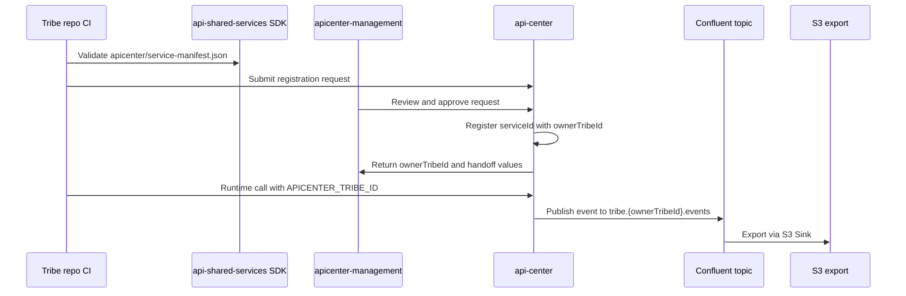

# APICenter Tribe Registration Rollout Implementation Plan

> **For agentic workers:** REQUIRED SUB-SKILL: Use superpowers:subagent-driven-development (recommended) or superpowers:executing-plans to implement this plan task-by-task. Steps use checkbox (`- [ ]`) syntax for tracking.

**Goal:** Move APICenter from the completed branch work into a controlled production rollout where visibility, event topics, and S3 export are owned per tribe while every microservice still registers its own `serviceId`.

**Architecture:** API Center remains the source of truth for service registry, `ownerTribeId` validation, registration requests, routing, and audit. `apicenter-management` remains the operator approval console and migration control surface. `api-shared-services` provides the SDK, manifest template, validator, and tribe-repo automation docs so each tribe can submit a manifest without direct production activation.

**Tech Stack:** NestJS 11, Prisma/Postgres/Supabase migrations, GKE, GitHub Actions, Next.js 16 on Vercel, TypeScript SDK package `@implementsprint/sdk`, Confluent Cloud Kafka, Confluent S3 Sink, AWS S3.

---

## Current State Snapshot

This plan starts from the local state verified on 2026-05-20.

| Repo | Branch | Local head | Current role |
| --- | --- | --- | --- |
| `C:\Codes\apic\api-center` | `codex/tribe-registration-automation` | `b1f2e87 Fix contract snapshot tests in CI` | API registry, DB migration, registration request endpoints, smoke checks |
| `C:\Codes\apic\apicenter-management` | `codex/registration-request-management` | `385d750 Add registration request management flow` | Approval queue, manifest tools, owner migration UI |
| `C:\Codes\apic\api-shared-services` | `main` | `9f42359 Add service manifest automation docs` | SDK docs, manifest validator, GitHub Actions handoff docs |

Known PRs from the current rollout context:

| Repo | PR |
| --- | --- |
| `api-center` | https://github.com/ImplementSprint/api-center/pull/1 |
| `apicenter-management` | https://github.com/ImplementSprint/apicenter-management/pull/1 |

Important current local warning:

- `apicenter-management` has uncommitted local changes in `src/app/api/local/confluent/topic-migrations/route.test.ts`, `src/components/confluent-provisioning-card.test.tsx`, and `.local-state/`.
- Do not overwrite or clean those files during this rollout unless their owner explicitly confirms they are disposable.

## Boundary Decisions

- Visibility is per tribe, not per microservice.
- The canonical ownership field is `ownerTribeId`.
- `APICENTER_TRIBE_ID` is the authenticated tribe principal and event ownership boundary.
- `APICENTER_SERVICE_ID` is the concrete backend or microservice identity used for routing and event attribution.
- Tribe-owned event topics follow the pattern `tribe.{ownerTribeId}.events`, with environment prefixes such as `test.tribe.flow-ci.events` and `prod.tribe.flow-ci.events`.
- Microservices do not receive separate Kafka topics or secrets by default.
- Backward compatibility remains `ownerTribeId ?? serviceId` until legacy entries are migrated.
- Automate validation and request submission from tribe repos; keep production approval manual through APICenter operators.

## End-State Flow



## Execution Rules

- Run read-only verification first, then merge, then database migration, then deployments.
- Do not push directly to `origin/main` for `api-center` or `apicenter-management`; use PR merge after explicit approval.
- Production mutations require a named approval from the repo/platform owner:
  - merging PRs
  - applying Supabase production migrations
  - pushing API Center release tags
  - changing Vercel production deployment
  - publishing a new SDK package version
  - changing Confluent production connector topics
- If any phase fails, stop at that phase and do not start the next production mutation.
- Keep the old registration path and old topics working until the pilot and legacy migration checks pass.

---

## Phase 0: Refresh Live State

**Purpose:** Ensure this plan still matches GitHub, local branches, and deployment state before any mutation.

**Files and commands:**

- Read: `api-center/.github/workflows/ci.yml`
- Read: `api-center/.github/workflows/deploy.yml`
- Read: `api-center/package.json`
- Read: `apicenter-management/package.json`
- Read: `api-shared-services/.github/workflows/create-sdk-release.yml`
- Read: `api-shared-services/package.json`

- [ ] **Step 1: Confirm local branch state**

Run:

```powershell
cd C:\Codes\apic\api-center
git status --short --branch
git log -1 --oneline

cd C:\Codes\apic\apicenter-management
git status --short --branch
git log -1 --oneline

cd C:\Codes\apic\api-shared-services
git status --short --branch
git log -1 --oneline
```

Expected:

- `api-center` is on `codex/tribe-registration-automation`.
- `apicenter-management` is on `codex/registration-request-management`.
- `api-shared-services` is on `main`.
- Any uncommitted `apicenter-management` files are reviewed before running formatters or broad test updates.

- [ ] **Step 2: Confirm PR checks**

Run:

```powershell
gh pr view 1 --repo ImplementSprint/api-center --json state,isDraft,mergeStateStatus,reviewDecision,headRefName,baseRefName,url
gh pr checks 1 --repo ImplementSprint/api-center --watch

gh pr view 1 --repo ImplementSprint/apicenter-management --json state,isDraft,mergeStateStatus,reviewDecision,headRefName,baseRefName,url
gh pr checks 1 --repo ImplementSprint/apicenter-management --watch
```

Expected:

- Both PRs are open.
- Required checks are passing.
- Base branch is `main`.
- Draft status is either intentionally kept for review or removed before merge.

- [ ] **Step 3: Confirm deployed API health before changes**

Run:

```powershell
Invoke-WebRequest -UseBasicParsing https://api-center-test.itsandbox.site/api/v1/health/live
Invoke-WebRequest -UseBasicParsing https://api-center-test.itsandbox.site/api/v1/health/ready
```

Expected:

- `/live` returns HTTP 200.
- `/ready` returns HTTP 200 and includes healthy registry, Kafka, Redis, and circuit-breaker checks.

---

## Phase 1: Merge Readiness Gates

**Purpose:** Re-run the important local gates and ensure the branches are safe to merge.

### Task 1: API Center Verification

**Files:**

- Verify: `api-center/src/registry/registration-requests.service.spec.ts`
- Verify: `api-center/src/registry/registry.service.spec.ts`
- Verify: `api-center/src/contracts/shared-service-contract.spec.ts`
- Verify: `api-center/scripts/smoke-tribe-boundary.js`
- Verify: `api-center/prisma/schema.prisma`
- Verify: `api-center/supabase/migrations/20260520000000_add_service_registration_requests.sql`

- [ ] **Step 1: Run API Center gates**

Run:

```powershell
cd C:\Codes\apic\api-center
npm run db:generate
npm run db:validate
npm run lint
npm run check:boundaries
npm run check:contracts
npm run typecheck
npm test
npm run test:e2e
npm run build
npm run smoke:tribe-boundary:check-config
```

Expected:

- Prisma generate and validate pass.
- Lint exits 0.
- Boundary and contract checks exit 0.
- Jest unit tests and e2e tests pass.
- Build exits 0.
- Tribe boundary smoke config check confirms all required env keys are present or clearly reports the missing keys before live smoke is attempted.

- [ ] **Step 2: Run live smoke only when secrets are loaded**

Run:

```powershell
cd C:\Codes\apic\api-center
if (-not $env:APICENTER_TRIBE_SECRET) { throw "APICENTER_TRIBE_SECRET must be loaded from the target secret store before live smoke." }
npm run smoke:tribe-boundary
```

Expected:

- The smoke creates or uses a tribe-owned service context.
- Runtime identity is `APICENTER_TRIBE_ID`.
- Event attribution is `APICENTER_SERVICE_ID`.
- Topic resolution uses the owner tribe topic pattern, such as `tribe.flow-ci.events`.

### Task 2: Management Verification

**Files:**

- Verify: `apicenter-management/src/components/registration-requests-client.tsx`
- Verify: `apicenter-management/src/components/manifest-tools-client.tsx`
- Verify: `apicenter-management/src/lib/service-registration-policy.ts`
- Verify: `apicenter-management/src/lib/owner-tribe-migration.ts`
- Verify: `apicenter-management/docs/operations/apicenter-management-runbook.md`

- [ ] **Step 1: Preserve local dirty state**

Run:

```powershell
cd C:\Codes\apic\apicenter-management
git diff -- src/app/api/local/confluent/topic-migrations/route.test.ts src/components/confluent-provisioning-card.test.tsx
git status --short
```

Expected:

- Any existing dirty changes are understood before test fixes or formatting.
- No command in this phase deletes `.local-state/`.

- [ ] **Step 2: Run management gates**

Run:

```powershell
cd C:\Codes\apic\apicenter-management
npm run lint
npm test
npm run build
```

Expected:

- Lint exits 0.
- Vitest tests pass, including registration requests, manifest tools, owner migration, and service registration policy.
- Next build exits 0.

### Task 3: SDK Verification

**Files:**

- Verify: `api-shared-services/templates/service-manifest.json`
- Verify: `api-shared-services/scripts/validate-service-manifest.js`
- Verify: `api-shared-services/src/types.ts`
- Verify: `api-shared-services/src/TribeClient.ts`
- Verify: `api-shared-services/docs/service-manifest-automation.md`
- Verify: `api-shared-services/docs/github-actions-registration-request.md`

- [ ] **Step 1: Run SDK gates**

Run:

```powershell
cd C:\Codes\apic\api-shared-services
npm run manifest:validate -- templates/service-manifest.json
npm run typecheck
npm run test
npm run build
npm run pack:check
npm run ci
```

Expected:

- Manifest validation prints `APICENTER_TRIBE_ID`, `APICENTER_SERVICE_ID`, and an owner tribe topic such as `topic=tribe.flow-ci.events`.
- Typecheck, tests, build, pack check, and CI script pass.

---

## Phase 2: PR Merge

**Purpose:** Move reviewed implementation branches to `main` without bypassing branch protection.

- [ ] **Step 1: Mark API Center PR ready when review starts**

Run only after the owner confirms the branch is ready for review:

```powershell
gh pr ready 1 --repo ImplementSprint/api-center
```

Expected:

- PR #1 for `api-center` is no longer draft.

- [ ] **Step 2: Mark Management PR ready when review starts**

Run only after the owner confirms the branch is ready for review:

```powershell
gh pr ready 1 --repo ImplementSprint/apicenter-management
```

Expected:

- PR #1 for `apicenter-management` is no longer draft.

- [ ] **Step 3: Merge API Center after approval**

Run only after checks pass and the repository owner approves the merge:

```powershell
gh pr merge 1 --repo ImplementSprint/api-center --squash --delete-branch
```

Expected:

- `api-center/main` contains the registration request API, DB migration, owner validation, CI hardening, and smoke script.

- [ ] **Step 4: Merge Management after API Center**

Run only after API Center is merged and the management PR is approved:

```powershell
gh pr merge 1 --repo ImplementSprint/apicenter-management --squash --delete-branch
```

Expected:

- `apicenter-management/main` contains the registration request page, local proxy routes, manifest tools updates, owner migration helper, and runbook updates.

---

## Phase 3: Database Migration

**Purpose:** Add the production table needed for registration requests and confirm the existing owner-tribe field remains healthy.

**Files:**

- Apply: `api-center/supabase/migrations/20260519000000_add_owner_tribe_id.sql`
- Apply: `api-center/supabase/migrations/20260520000000_add_service_registration_requests.sql`
- Verify: `api-center/prisma/schema.prisma`

- [ ] **Step 1: Confirm target Supabase project**

Run:

```powershell
cd C:\Codes\apic\api-center
supabase status
supabase migration list
```

Expected:

- The linked project is the intended target environment.
- `20260519000000_add_owner_tribe_id.sql` is already applied or queued.
- `20260520000000_add_service_registration_requests.sql` is queued if not already applied.

- [ ] **Step 2: Create a pre-migration schema backup**

Run:

```powershell
cd C:\Codes\apic\api-center
New-Item -ItemType Directory -Force -Path .\supabase\backups
supabase db dump --linked --schema public --file .\supabase\backups\2026-05-20-before-registration-requests.sql
```

Expected:

- A schema dump exists at `supabase/backups/2026-05-20-before-registration-requests.sql`.

- [ ] **Step 3: Dry-run migration**

Run:

```powershell
cd C:\Codes\apic\api-center
npm run db:migration:push:dry
```

Expected:

- The dry run shows only the intended owner-tribe and service registration request schema changes.
- No unrelated table drops, enum rewrites, or destructive data operations appear.

- [ ] **Step 4: Apply migration**

Run only after explicit approval for the target environment:

```powershell
cd C:\Codes\apic\api-center
npm run db:migration:push
```

Expected:

- Migration succeeds.
- Prisma schema remains valid.

- [ ] **Step 5: Verify schema in Supabase SQL editor**

Run this SQL against the target database:

```sql
select column_name, data_type, is_nullable
from information_schema.columns
where table_schema = 'public'
  and table_name = 'service_registration_requests'
order by ordinal_position;

select indexname
from pg_indexes
where schemaname = 'public'
  and tablename = 'service_registration_requests'
order by indexname;

select column_name
from information_schema.columns
where table_schema = 'public'
  and table_name = 'services'
  and column_name = 'owner_tribe_id';
```

Expected:

- `service_registration_requests` has `id`, `service_id`, `owner_tribe_id`, `status`, `requested_by`, `manifest`, `validation_report`, `reviewed_by`, `reviewed_at`, `rejection_reason`, `created_at`, and `updated_at`.
- Indexes include `service_registration_requests_owner_idx`.
- `services.owner_tribe_id` exists.

---

## Phase 4: API Center Deploy

**Purpose:** Deploy API Center after the DB is ready, then verify live registration request and tribe boundary behavior.

**Deployment mechanism:**

- `api-center/.github/workflows/deploy.yml` deploys on tags matching `v*.*.*`.
- The workflow builds an image, pushes to Artifact Registry, sets the GKE deployment image, waits for rollout, and shows HPA status.

- [ ] **Step 1: Sync local main**

Run:

```powershell
cd C:\Codes\apic\api-center
git checkout main
git pull --ff-only origin main
```

Expected:

- Local `main` contains the merged PR commit.

- [ ] **Step 2: Choose release version**

Run:

```powershell
cd C:\Codes\apic\api-center
if (-not $env:APICENTER_RELEASE_VERSION) { throw "Set APICENTER_RELEASE_VERSION to the approved API Center release version, for example 1.0.1." }
git tag "v$env:APICENTER_RELEASE_VERSION"
git push origin "v$env:APICENTER_RELEASE_VERSION"
```

Expected:

- A tag such as `v1.0.1` is pushed.
- GitHub Actions `Deploy` starts for `api-center`.

- [ ] **Step 3: Watch deployment**

Run:

```powershell
gh run list --repo ImplementSprint/api-center --workflow Deploy --limit 5
gh run watch --repo ImplementSprint/api-center
```

Expected:

- Build and push succeeds.
- GKE rollout succeeds.
- HPA status is visible.

- [ ] **Step 4: Verify live health**

Run:

```powershell
Invoke-WebRequest -UseBasicParsing https://api-center-test.itsandbox.site/api/v1/health/live
Invoke-WebRequest -UseBasicParsing https://api-center-test.itsandbox.site/api/v1/health/ready
```

Expected:

- Live and ready health endpoints return HTTP 200.
- Ready includes registry and Kafka health.

- [ ] **Step 5: Verify registration request API**

Run against the target environment with an operator token loaded in `APICENTER_ADMIN_TOKEN`:

```powershell
if (-not $env:APICENTER_ADMIN_TOKEN) { throw "APICENTER_ADMIN_TOKEN must be loaded before API registration request verification." }
$headers = @{ Authorization = "Bearer $env:APICENTER_ADMIN_TOKEN"; "Content-Type" = "application/json" }
Invoke-WebRequest -UseBasicParsing -Method Get -Headers $headers https://api-center-test.itsandbox.site/api/v1/registry/registration-requests
```

Expected:

- API returns HTTP 200.
- Empty queues return an empty list, not an error.
- Existing pending requests include `serviceId`, `ownerTribeId`, `status`, `manifest`, and `validationReport`.

---

## Phase 5: Management Deploy

**Purpose:** Deploy the approval UI after API Center can serve registration request endpoints.

**Deployment mechanism:**

- `apicenter-management` has no local `.github/workflows` directory in the current checkout.
- Treat Vercel as the production deployment path unless the repository owner provides a different deployment command.

- [ ] **Step 1: Sync management main**

Run:

```powershell
cd C:\Codes\apic\apicenter-management
git checkout main
git pull --ff-only origin main
```

Expected:

- Local `main` contains the merged registration request management PR.

- [ ] **Step 2: Verify required Vercel environment**

Confirm these values exist in the Vercel project environment:

```text
APICENTER_API_BASE_URL
APICENTER_ADMIN_TOKEN or the configured operator auth token path
GOOGLE_CLOUD_PROJECT
```

Expected:

- Management can call API Center server-side local proxy routes.
- Management can still read required GCP Secret Manager metadata for tribe secret status.

- [ ] **Step 3: Deploy through Vercel**

Use the Vercel production deployment flow attached to `apicenter-management/main`.

Expected:

- The production deployment builds successfully.
- `/registration-requests` is available behind the expected management auth gate.
- `/manifest-tools` still opens and can dry-run manifests.

- [ ] **Step 4: Verify management pages**

Open these routes:

```text
/registration-requests
/manifest-tools
/tribes
```

Expected:

- Registration Requests loads pending requests.
- Manifest Tools shows `APICENTER_TRIBE_ID`, `APICENTER_SERVICE_ID`, and an owner tribe topic such as `topic=tribe.flow-ci.events` during dry-run.
- Tribe service detail pages show owner tribe information and Confluent status against the owner topic.

---

## Phase 6: SDK Release And Tribe Repo Handoff

**Purpose:** Ensure tribe teams can install a package version that includes the new types, manifest validator docs, and `sourceServiceId` event attribution guidance.

**Current package state:**

- `api-shared-services/package.json` currently shows `@implementsprint/sdk` version `1.2.0`.
- If `1.2.0` was already published before `ServiceRegistrationRequest` types or manifest automation docs landed, publish `1.2.1`.

- [ ] **Step 1: Confirm current published package version**

Run:

```powershell
cd C:\Codes\apic\api-shared-services
npm view @implementsprint/sdk version --registry=https://npm.pkg.github.com
```

Expected:

- The command returns the latest package version visible to the authenticated GitHub Packages user.

- [ ] **Step 2: Dry-run SDK release workflow**

Run:

```powershell
gh workflow run create-sdk-release.yml --repo ImplementSprint/api-shared-services --ref main -f version=1.2.1 -f dry_run=true
gh run watch --repo ImplementSprint/api-shared-services
```

Expected:

- Workflow validates package metadata, release tag, tests, typecheck, build, and package contents.
- It does not create a tag or publish because `dry_run=true`.

- [ ] **Step 3: Publish SDK release if needed**

Run only after the dry run passes and the owner approves the package release:

```powershell
gh workflow run create-sdk-release.yml --repo ImplementSprint/api-shared-services --ref main -f version=1.2.1 -f dry_run=false
gh run watch --repo ImplementSprint/api-shared-services
```

Expected:

- Workflow commits the version bump if needed.
- Tag `v1.2.1` is created.
- `@implementsprint/sdk@1.2.1` is published to GitHub Packages.

- [ ] **Step 4: Provide tribe repo handoff**

Give tribe teams these required repo files:

```text
apicenter/service-manifest.json
scripts/validate-service-manifest.js
.github/workflows/apicenter-registration-request.yml
```

Required runtime environment names:

```text
APICENTER_URL
APICENTER_TRIBE_ID
APICENTER_SERVICE_ID
APICENTER_TRIBE_SECRET
```

Required CI secret names:

```text
APICENTER_REGISTRATION_REQUEST_URL
APICENTER_MANAGEMENT_TOKEN
GITHUB_TOKEN
```

Expected:

- Tribe runtime uses `APICENTER_TRIBE_ID=flow-ci` when `ownerTribeId` is `flow-ci`.
- Tribe runtime uses `APICENTER_SERVICE_ID=flow-ci-api` when `serviceId` is `flow-ci-api`.
- Tribe CI validates the manifest and submits a registration request.
- Tribe CI does not directly activate production registry entries.

---

## Phase 7: Pilot Service

**Purpose:** Prove the full flow with one non-critical service before migrating every legacy entry.

**Recommended pilot shape:**

```json
{
  "serviceId": "flow-ci-api",
  "ownerTribeId": "flow-ci",
  "serviceType": "tribe",
  "baseUrl": "https://flow-ci-api.example.internal",
  "exposes": ["/health"],
  "consumes": [],
  "requiredScopes": ["flow-ci:read"],
  "healthCheck": "/health"
}
```

- [ ] **Step 1: Submit pilot registration request**

From the tribe repo or local validation checkout, run:

```powershell
node scripts/validate-service-manifest.js apicenter/service-manifest.json
```

Expected output includes:

```text
APICENTER_TRIBE_ID=flow-ci
APICENTER_SERVICE_ID=flow-ci-api
topic=tribe.flow-ci.events
```

- [ ] **Step 2: Approve request in management**

Open:

```text
/registration-requests
```

Expected:

- Pending request shows `serviceId=flow-ci-api`.
- Pending request shows `ownerTribeId=flow-ci`.
- Validation report has no blocking issue.
- Approval registers or updates the service in API Center.

- [ ] **Step 3: Verify registry**

Run:

```powershell
if (-not $env:APICENTER_ADMIN_TOKEN) { throw "APICENTER_ADMIN_TOKEN must be loaded before registry verification." }
$headers = @{ Authorization = "Bearer $env:APICENTER_ADMIN_TOKEN" }
Invoke-WebRequest -UseBasicParsing -Headers $headers https://api-center-test.itsandbox.site/api/v1/registry/services
```

Expected:

- Response includes `flow-ci-api`.
- Response includes `ownerTribeId: "flow-ci"`.

- [ ] **Step 4: Verify topic and S3 path**

In management service detail and Confluent status views, verify:

```text
logical topic: tribe.flow-ci.events
physical test topic: test.tribe.flow-ci.events
physical prod topic: prod.tribe.flow-ci.events
```

Expected:

- Management does not resolve `tribe.flow-ci-api.events`.
- S3 Sink topic inclusion uses the owner tribe topic.

---

## Phase 8: Legacy Migration

**Purpose:** Update old service-only registrations to the new owner-tribe model while preserving compatibility until each service is verified.

- [ ] **Step 1: Export current registry**

Open:

```text
/manifest-tools
```

Expected:

- Registry export includes existing service manifests.
- Legacy entries without `ownerTribeId` are visible.

- [ ] **Step 2: Prepare owner migration**

In Manifest Tools, click:

```text
Prepare owner migration
```

Expected:

- Generated manifests fill `ownerTribeId`.
- Services that are already tribe principals keep `ownerTribeId === serviceId`.
- Microservices under a tribe get `ownerTribeId` set to the owning tribe principal.

- [ ] **Step 3: Review migration output**

For each migrated service, verify:

```text
serviceId stays unchanged
baseUrl stays unchanged
exposes stays unchanged
consumes stays unchanged
requiredScopes stays unchanged
ownerTribeId is added or corrected
```

Expected:

- Routing identity does not change.
- Event topic ownership changes only when a microservice previously used a service-owned topic.

- [ ] **Step 4: Apply low-risk migration batch**

Apply a small batch first:

```text
1 tribe principal
1 owned microservice
1 shared service if present
```

Expected:

- Registry update succeeds.
- Old token flow still works for legacy entries.
- New token/event flow works for the migrated microservice.

- [ ] **Step 5: Expand migration by tribe**

Migrate one tribe at a time:

```text
owner tribe principal
owned microservices
topic status
S3 Sink inclusion
event smoke
consumer smoke
```

Expected:

- Every migrated service has an owner.
- No service loses routing or dependency permissions.

---

## Phase 9: Event Topic Cutover

**Purpose:** Move active event producers from old service-derived topics to tribe-owned topics.

- [ ] **Step 1: Build topic map**

For every tribe-owned microservice, record:

```text
old topic pattern: tribe.{serviceId}.events
new topic pattern: tribe.{ownerTribeId}.events
sourceServiceId value: serviceId
```

Concrete example:

```text
old topic: tribe.flow-ci-api.events
new topic: tribe.flow-ci.events
sourceServiceId: flow-ci-api
```

Expected:

- Multiple microservices can map to the same owner tribe topic.
- Each event remains attributable through `sourceServiceId`.

- [ ] **Step 2: Enable new topic in Confluent**

Use management topic provisioning for:

```text
tribe.flow-ci.events
```

Expected:

- Topic exists in the target environment with the configured prefix.
- ACLs permit APICenter producers and S3 Sink consumers.

- [ ] **Step 3: Add new topic to S3 Sink**

Update Confluent S3 Sink topic inclusion:

```text
prod.tribe.flow-ci.events
```

Expected:

- S3 Sink accepts the new topic.
- New objects land under the expected S3 topic prefix.

- [ ] **Step 4: Update producers**

In each tribe backend, configure:

```text
APICENTER_TRIBE_ID=flow-ci
APICENTER_SERVICE_ID=flow-ci-api
```

Publish through SDK:

```ts
await client.publishTribeEvent({
  eventType: "service.pilot.checked",
  payload: { ok: true },
  sourceServiceId: process.env.APICENTER_SERVICE_ID,
});
```

Expected:

- SDK publishes to `tribe.<APICENTER_TRIBE_ID>.events`.
- Event metadata contains `sourceServiceId`.

- [ ] **Step 5: Observe dual-running window**

Keep old and new topics during the observation window.

Expected:

- New topic receives events.
- S3 export receives events.
- Consumers can distinguish microservice source through metadata.
- Old topic traffic drops to zero before removal.

---

## Phase 10: Cutover And Cleanup

**Purpose:** Finish the migration once all services use `ownerTribeId`.

- [ ] **Step 1: Block new legacy registrations**

Keep API Center validation active:

```text
ownerTribeId is required for tribe microservices
ownerTribeId must reference an existing owner tribe
serviceId remains unique
```

Expected:

- New microservice manifests without `ownerTribeId` are rejected with a clear validation issue.

- [ ] **Step 2: Update docs and runbooks**

Review these docs:

```text
api-center/docs/apicenter-platform-setup.md
api-center/docs/confluent-cloud-s3-sink-setup.md
api-center/docs/data-pipeline/tribe-event-contract.md
api-center/docs/data-pipeline/new-tribe-s3-onboarding-runbook.md
apicenter-management/docs/operations/apicenter-management-runbook.md
api-shared-services/docs/service-manifest-automation.md
api-shared-services/docs/github-actions-registration-request.md
api-shared-services/docs/tribe-event-payload-instructions.md
```

Expected:

- All docs describe `ownerTribeId` as the tribe boundary.
- All examples separate `APICENTER_TRIBE_ID` and `APICENTER_SERVICE_ID`.
- No doc recommends per-microservice topics by default.

- [ ] **Step 3: Remove old topic references only after zero traffic**

Before removing an old topic from S3 Sink, verify:

```text
old topic has no producer traffic
new topic has producer traffic
new topic has S3 objects
downstream consumers have confirmed the new prefix
rollback window has expired
```

Expected:

- Old topics are removed from connector config only after downstream confirmation.

---

## Phase 11: Rollback Plan

**Purpose:** Define what to do when one layer fails without making the system worse.

| Failure point | Rollback action | Compatibility expectation |
| --- | --- | --- |
| API Center deploy fails | Revert release tag deployment through previous GKE image | DB migration can remain if additive |
| DB migration fails before apply | Do not deploy API Center branch | Old registry remains active |
| DB migration fails after apply | Restore from Supabase backup only if additive schema causes runtime failure | Old APIs should ignore unused table |
| Management deploy fails | Revert Vercel production deployment | API Center direct admin routes still exist |
| SDK publish fails | Keep existing package version and handoff docs | Runtime API can still work with raw `kafkaPublish` if `sourceServiceId` is passed |
| Registration request API fails | Hide or disable `/registration-requests` nav, keep direct operator import path | Existing service registration path remains |
| Owner validation blocks a valid service | Register owner tribe first, then retry microservice request | Validation protects orphaned services |
| New topic export fails | Keep old topic in S3 Sink and pause producer cutover | Legacy topic path remains until zero traffic |

---

## Go/No-Go Checklist

Production go requires all of these:

- [ ] `api-center` PR merged through review, not direct-pushed to `main`.
- [ ] `apicenter-management` PR merged through review, not direct-pushed to `main`.
- [ ] Supabase migration dry-run reviewed.
- [ ] Supabase migration applied.
- [ ] API Center deployed and health endpoints return HTTP 200.
- [ ] Registration request API returns HTTP 200.
- [ ] Management production deployment loads `/registration-requests`.
- [ ] SDK release decision is complete: either current package already has the changes or `1.2.1` is published.
- [ ] Pilot service registers with `serviceId` and `ownerTribeId`.
- [ ] Pilot event publishes to an owner tribe topic such as `tribe.flow-ci.events`.
- [ ] Pilot S3 export lands under the owner tribe topic path.
- [ ] Legacy migration plan has an owner per service.
- [ ] Old service-derived topics remain until zero traffic is proven.

No-go if any of these are true:

- [ ] PR checks are failing.
- [ ] Supabase migration dry-run shows destructive changes.
- [ ] API Center cannot read the registry after deploy.
- [ ] Management cannot call API Center request routes.
- [ ] Tribe-owned event publish resolves to a service-derived topic such as `tribe.flow-ci-api.events` for a microservice.
- [ ] S3 Sink cannot consume the new owner tribe topic.
- [ ] A service loses `baseUrl`, `exposes`, `consumes`, or `requiredScopes` during owner migration.

## Final Handoff

After rollout, tribe teams should receive this short contract:

```text
Register a service manifest with:
- serviceId: your backend or microservice ID
- ownerTribeId: your tribe principal ID
- exposes: routes APICenter may route to
- consumes: services your backend may call
- requiredScopes: scopes your backend needs

Runtime env:
- APICENTER_URL=https://api-center.itsandbox.site
- APICENTER_TRIBE_ID=flow-ci
- APICENTER_SERVICE_ID=flow-ci-api
- APICENTER_TRIBE_SECRET is loaded from the platform handoff and is never committed

Events:
- publish to tribe-owned topic through the SDK
- use sourceServiceId for microservice attribution
- do not create per-service topics unless platform explicitly approves isolation
```
